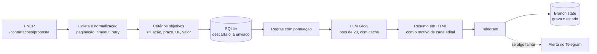
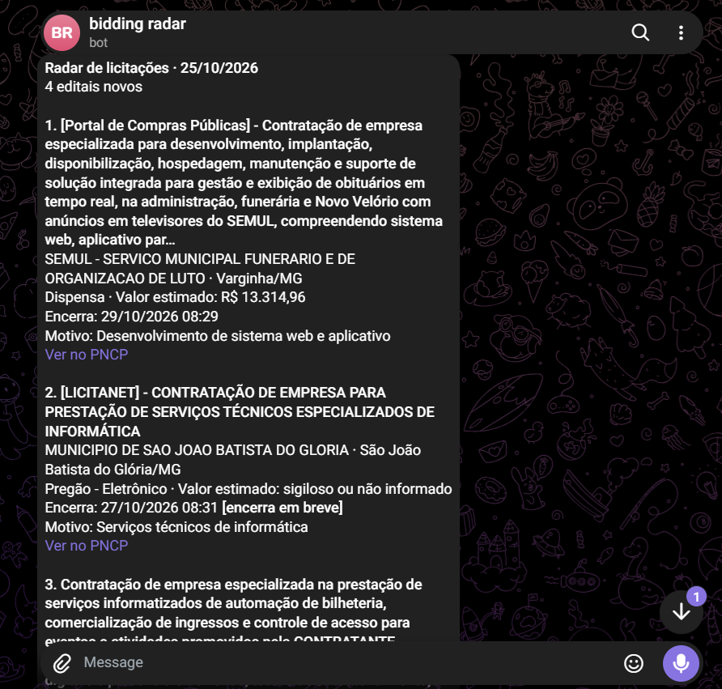
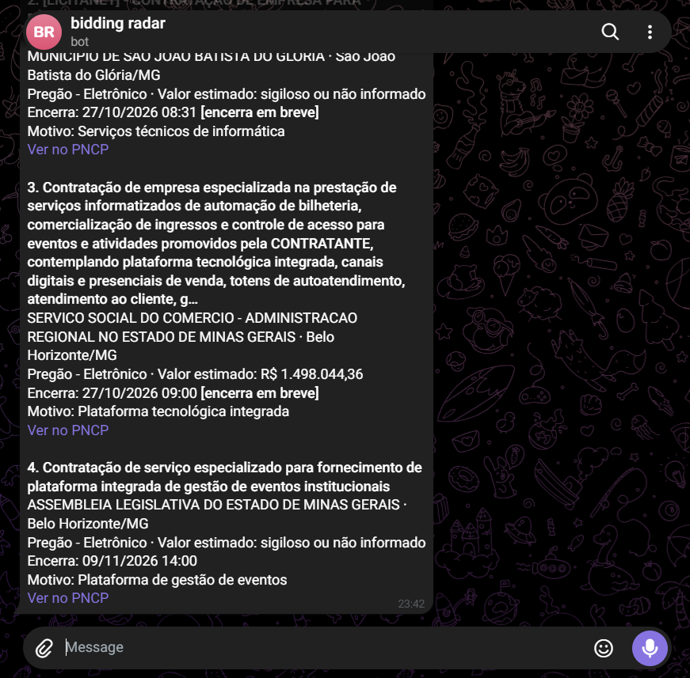

# Radar de licitações

[](https://github.com/henriqueecss/salto-02-radar-licitacoes/actions/workflows/ci.yml) [](https://github.com/henriqueecss/salto-02-radar-licitacoes/actions/workflows/radar.yml) 

Job diário que consulta o Portal Nacional de Contratações Públicas (PNCP), filtra os editais de desenvolvimento de software abertos em Minas Gerais e manda um resumo no Telegram.

**Em números:** numa execução real, de 3.075 editais abertos em MG o radar entregou 4. Recall de 100% nos exemplos rotulados e custo zero (GitHub Actions, SQLite e o plano gratuito do Groq).

## O problema

Uma pequena software house desenvolve sites, sistemas web e aplicativos. Prefeituras e câmaras compram exatamente isso por licitação, e os editais saem todo dia no PNCP. Só que ninguém na empresa tem tempo de olhar o portal: num dia comum há mais de 3.000 contratações com proposta aberta só em MG, e quase todas são de merenda, pneu, obra e material de escritório. Os editais bons passam sem ninguém ver.

## A solução

Todo dia útil, às 8h (Brasília), um workflow do GitHub Actions roda este fluxo:



O pipeline (`src/pipeline.ts`) recebe coleta, envio e banco por injeção. Por isso o teste ponta a ponta roda sem rede, com respostas reais do PNCP gravadas em `tests/fixtures/`.

Resumo real recebido na execução de 26/10/2026:

| | |
|---|---|
|  |  |

## Decisões principais

Os detalhes, com as alternativas descartadas, estão em [DECISOES.md](DECISOES.md).

| Decisão | Escolha | Por quê, em uma linha |
|---|---|---|
| Endpoint | `/proposta` (abertas agora) | se o job falhar um dia, nada se perde: o edital continua aberto no dia seguinte |
| Filtro | regras com pontuação | explicável, ajustável para priorizar recall e já dá a pontuação de aderência |
| LLM | Groq gratuito como segunda etapa, em lotes e com cache | entende o contexto que a lista de palavras não pega, sem custo |
| Estado | SQLite commitado na branch `state` | grátis, auditável e não polui a `main` |
| API instável | timeout, backoff e, se a coleta falhar, nada é enviado nem gravado | o job é idempotente: a próxima execução recupera tudo |
| Mensagem | um resumo diário | não vira spam; quando passa de 4.096 caracteres, é dividido sem cortar edital |

## Resultados

A meta era **recall de 100%** (nenhuma oportunidade perdida) e **precisão de pelo menos 85%**. Recall vem primeiro porque os erros têm custos assimétricos: um edital irrelevante custa 10 segundos de leitura, um edital bom perdido pode custar um contrato.

| Conjunto | Filtro | Recall | Precisão |
|---|---|---|---|
| 40 objetos rotulados (`data/`) | regras | 100% (15/15) | 100% (15/15) |
| mesmos 40 | regras + LLM | 100% (15/15) | 100% (15/15) |
| 20 editais reais de 23/10/2026 | regras antes do ajuste | 100% (4/4) | **40%** (4/10) |
| mesmos 20 editais | regras depois do ajuste | 100% (4/4) | 80% (4/5) |
| mesmos 20 editais | regras + LLM (`qwen/qwen3.8-27b`) | 100% (4/4) | 100% (4/4) |
| 7 editais reais enviados em 26 e 27/10/2026 | regras + LLM, prompt anterior | 60% (3/5) | 75% (3/4) |
| mesmos 7 editais | regras + LLM, prompt ajustado | 100% (5/5) | 100% (5/5) |

O resultado com LLM se repetiu em quatro execuções. Como ler esses números:

- **Os 100% do conjunto rotulado não provam nada sozinhos.** As regras foram escritas olhando esses 40 exemplos. No dia real, o filtro aprovou 15 de 3.027 editais, e a maioria era licença de software pronto, SaaS ou gestão de frota por cartão.
- **O ajuste corrigiu categorias, não editais:** licença e SaaS viraram veto e o prefixo da plataforma (como "[Portal de Compras Públicas]") passou a ser removido antes da pontuação. Os 80% são otimistas, porque o ajuste veio depois de ver parte desses editais.
- **O LLM também erra.** Tirou a frota por cartão, mas aprovou um edital de geotecnologia com o motivo "Licenciamento de sistemas web e mobile", contra o próprio prompt. O `gpt-oss-120b` variou entre 66,7% e 100% de precisão no mesmo conjunto, por isso escolhi o `qwen`, que se manteve estável.
- **A evidência de recall é pequena e o gabarito é de uma pessoa só.** A amostra pegou 10 dos 337 rejeitados com vocabulário de TI. Um contrato ambíguo (suporte, rede e desenvolvimento) derruba a precisão de 80% para 60% se for marcado como "não".
- **O prompt foi ajustado olhando os 7 editais de 26 e 27/10**, então esses 100% também são otimistas. A medida honesta vem da próxima amostra, que o prompt ainda não viu.

## O que eu aprendi

- **Conjunto pequeno engana.** Só o dia real mostrou as armadilhas do edital de verdade.
- **O LLM funciona melhor como segunda etapa.** As regras, que são baratas, reduzem cerca de 3.000 editais a uns 350 candidatos, e o LLM julga só esses. É isso que cabe no plano gratuito.
- **Idempotência vale mais que lógica de recuperação.** Se o envio falhar, nada é gravado, e a próxima execução refaz tudo.

## Como rodar

Requisitos: Node 22.13 ou mais novo (o CI usa o Node 24 LTS, em que o `node:sqlite` é estável).

```bash
git clone https://github.com/henriqueecss/salto-02-radar-licitacoes.git
cd salto-02-radar-licitacoes
npm ci
cp .env.example .env    # preencha TELEGRAM_BOT_TOKEN e TELEGRAM_CHAT_ID
```

| Comando | O que faz |
|---|---|
| `npm test` | roda os testes (sem rede) |
| `npm run lint` | ESLint + checagem de tipos |
| `npm run evaluate` | recall e precisão no conjunto rotulado, com a pontuação de cada item |
| `npm run evaluate -- avaliacao/amostra_dia_real.csv --llm` | o mesmo, com regras + LLM, mostrando o motivo de cada veredito |
| `RADAR_DRY_RUN=1 npm start` | coleta de verdade e imprime o resumo no terminal, sem enviar nem gravar |
| `npm start` | execução completa: coleta, envia e grava o estado |
| `npm run sample-real-day` | monta uma amostra de 20 editais reais para rotular |

Configuração (no `.env` ou em Settings → Variables do repositório):

| Variável | Padrão | |
|---|---|---|
| `RADAR_UF` | `MG` | UF consultada |
| `RADAR_VALOR_MINIMO` / `RADAR_VALOR_MAXIMO` | `0` / sem limite | faixa de valor; valor zero ou ausente nunca exclui, porque o orçamento pode ser sigiloso |
| `RADAR_MODALIDADES` | `6,8,4` | pregão eletrônico, dispensa e concorrência eletrônica |
| `API_KEY` | vazio | chave do LLM; sem ela, o filtro usa só as regras |
| `LLM_BASE_URL` | `https://api.groq.com/openai/v1` | qualquer API compatível com `/chat/completions` da OpenAI |
| `LLM_MODEL` | `qwen/qwen3.8-27b` | modelo usado na classificação |

Para o job agendado, cadastre `TELEGRAM_BOT_TOKEN`, `TELEGRAM_CHAT_ID` e `API_KEY` (chave gratuita em console.groq.com) em Settings → Secrets and variables → Actions. Para disparar na hora, use Actions → Radar diario → Run workflow.

Pastas: `src/` (código, um módulo por etapa do fluxo), `tests/` (Vitest, um arquivo por módulo), `scripts/` (avaliação e gravação de fixtures), `data/` (40 objetos rotulados) e `avaliacao/` (amostras reais rotuladas).

## Limitações e próximos passos

- Medir de novo a precisão, com e sem LLM, numa amostra nova que nenhum dos dois viu.
- O plano gratuito do Groq muda sem aviso. Se ele apertar, a troca de provedor é só de configuração (`LLM_BASE_URL` e `LLM_MODEL`).
- Avisar quando um edital já enviado for suspenso ou revogado (a situação muda depois da publicação).
- Uma página web com histórico e filtros, lendo o SQLite da branch `state`.
- O GitHub desativa workflows agendados em repositórios públicos depois de 60 dias sem atividade.

## Licença

MIT. Veja o arquivo `LICENSE`.
